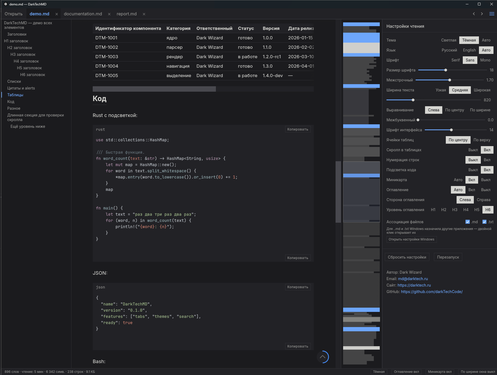

# DarkTechMD

Быстрая читалка Markdown на Rust + egui. Замена MarkMello: файл 50 МБ
открывается мгновенно, скролл никогда не дёргается.



Автор: **Dark Wizard** · https://darktech.ru · репозиторий:
[DarkTechCode/darktech-md-reader](https://github.com/DarkTechCode/darktech-md-reader)
· план проекта: [PLAN.md](PLAN.md)

## Скачать

**Windows x64** — один exe, без установщика и внешних рантаймов
(статический CRT, шрифты встроены):

→ [**DarkTechMD.exe**](https://github.com/DarkTechCode/darktech-md-reader/releases/latest/download/DarkTechMD.exe)

Скачал и запустил. Скачивание откроется прямо с GitHub Releases (кнопка
«Download» / «Скачать» в браузере). Другие версии и исходники — на странице
[Releases](https://github.com/DarkTechCode/darktech-md-reader/releases).

## Возможности

- **Виртуализация**: рендерится только видимое окно блоков; парсинг больших
  файлов — фоновым потоком, документ появляется по мере разбора.
  50 МБ → первый экран < 1 с, разбор 188 мс, память < 400 МБ (бюджеты —
  в PLAN §7, проверяются тестами `perf_smoke`).
- **Markdown**: заголовки h1–h6 с якорями, абзацы, **жирный**/*курсив*/
  `код` ~~зачёркнутый~~, ссылки, списки (вложенные, task list), цитаты и
  GFM-алерты, таблицы (перенос в ячейках), код с подсветкой syntect и
  нумерацией строк, `---`, локальные картинки (плейсхолдер в v1).
  Mermaid/HTML — блоками кода с подписью.
- **Поиск** (Ctrl+F): фоновой, регистронезависимый (латиница/кириллица),
  подсветка попаданий, автоскролл, Enter/F3 — навигация.
- **Выделение и копирование**: мышь/двойной/тройной клик, Ctrl+A/C,
  контекстное меню, «Копировать адрес» на ссылках; координаты выделения
  переживают виртуальный скролл.
- **Вкладки и сессия**: вкладки с позициями чтения, восстановление при
  старте (позиция — по якорю блока, выдерживает правки файла), последние
  файлы, геометрия окна.
- **Watcher**: файл изменился на диске → перечитка с сохранением позиции
  (debounce 300 мс); файл пропал → баннер «файл недоступен».
- **Панели**: оглавление (виртуализованное, текущий раздел подсвечен,
  сторона слева/справа), миникарта-скелет, статус-бар (слова, время чтения,
  статистика выделения, тумблеры темы и панелей).
- **Настройки**: тема, RU/EN, шрифты (Serif/Sans/Mono, встроены в exe),
  размер/межстрочный/ширина/межбуквенный/выравнивание, нумерация и подсветка
  кода, «по ширине окна», ассоциация `.md`/`.txt` (HKCU, с подсказкой при
  чужом UserChoice). `%APPDATA%\DarkTechMD\settings.json`.
- **Один exe**, статический CRT, без установщика и внешних
  зависимостей; иконка и метаданные вшиты (winres).

## Сборка

Windows, Rust (MSVC toolchain).

```
cargo build --release
```

Готовый exe: `target\x86_64-pc-windows-msvc\release\darktech-md.exe`
(рабочая копия хранится в `bin\DarkTechMD.exe`, вне git). Профиль release —
`lto = "fat"`, `codegen-units = 1`, `strip = "symbols"`.

Тесты:

```
cargo test                                          # парсер, бюджеты, watcher, поиск
cargo test --release --test perf_smoke -- --ignored # тяжёлые 50 МБ бюджеты
cargo run -- temp/demo.md                           # демо-документ
```

## Горячие клавиши

| Клавиши | Действие |
|---|---|
| Ctrl+O | открыть файл |
| Ctrl+F / F3 / Shift+F3 | поиск / далее / назад |
| Esc | закрыть поиск, снять выделение |
| Ctrl+A, Ctrl+C | выделить всё, копировать |
| Ctrl+Tab / Ctrl+Shift+Tab | вкладки |
| Ctrl+W | закрыть вкладку |
| Ctrl+= / Ctrl+- / Ctrl+0 | размер шрифта |
| Ctrl+1..3 | ширина текста |
| Средняя кнопка | автоскролл (браузерный) |

## Лицензия

Код — [MIT](LICENSE), © Dark Wizard. Шрифты (Inter, Noto Serif, JetBrains
Mono) встроены в exe; их лицензии OFL — в `assets/fonts/OFL-*.txt`.
